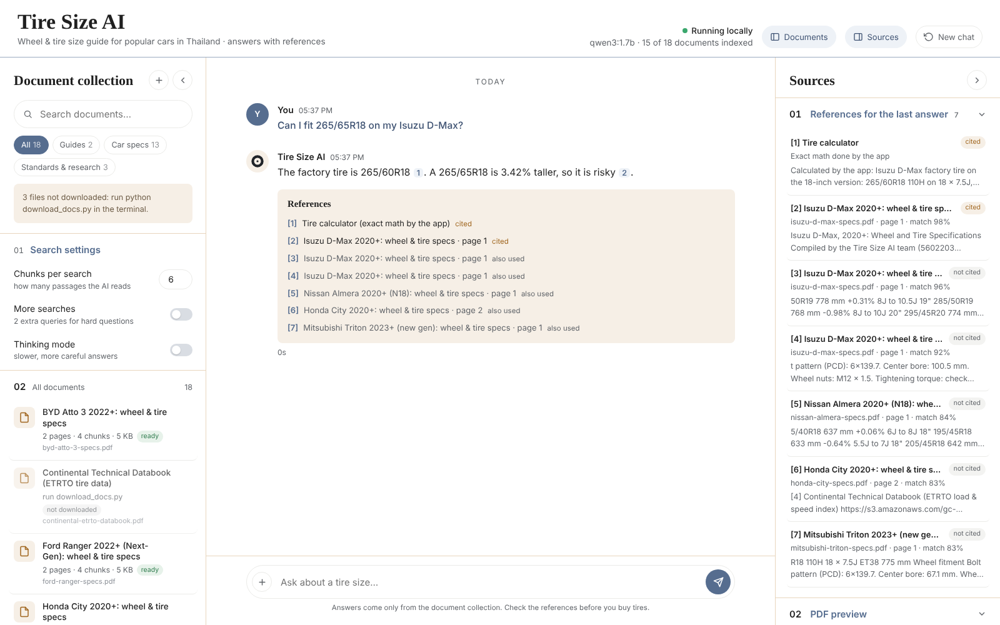

# Tire Size AI 🛞

A local AI chatbot that helps you pick the right wheel and tire size for popular cars in Thailand.
It runs on your own computer with [Ollama](https://ollama.com), answers only from the documents in
`docs/`, and **shows the references (file + page) for every answer**.

Course project for 5602203 Generative AI Literacy and Applications, Chulalongkorn University (BAScii).



## Quick start

**You need:** [Python 3.9+](https://www.python.org/downloads/) and [Ollama](https://ollama.com/download) (open the Ollama app first).

```bash
git clone https://github.com/YOUR-USERNAME/YOUR-REPO.git
cd YOUR-REPO
```

Then start it:

| Mac / Linux | Windows |
|---|---|
| `bash start.sh` | double-click `start.bat` |

The start script does everything: downloads the two models (first time only), installs the Python
packages in a `.venv` folder, downloads the extra research PDFs, starts the app and opens
**http://localhost:5000** in your browser. Press **Ctrl + C** in the terminal to stop.

<details>
<summary>Prefer to run the steps yourself?</summary>

```bash
ollama pull qwen3:1.7b
ollama pull nomic-embed-text
pip install -r requirements.txt
python download_docs.py     # optional: the 3 research PDFs
python app.py
```
</details>

The first start indexes every PDF in `docs/` (you can watch it in the terminal and in the app). After that it starts fast.

### Using the app
- Ask a question. Every answer has a **References** list. Click one to open the PDF at that page.
- **Documents** panel (left): the document collection, search settings, and **+** to upload your own PDFs.
- **Sources** panel (right): the references for the last answer, the PDF preview, and index info.
- Close either panel with its arrow button. Reopen it with the tab on the screen edge, the buttons at the top, or the keys `[` and `]`.

## No-Python version (GitHub Pages)

`tire-size-ai.html` is the same chatbot in **one file**, with the guide and spec sheet PDFs built in.
It talks to Ollama directly from the browser, so it doesn't need `app.py`.

- **On your computer:** start Ollama, then double-click `tire-size-ai.html`.
- **On GitHub Pages:** turn on Pages (Settings → Pages → Deploy from branch → `main` / root). The site opens `tire-size-ai.html`.
  The page still uses **your own** Ollama, so each visitor needs Ollama running and must allow the website to connect:
  - Mac / Linux: `OLLAMA_ORIGINS="*" ollama serve`
  - Windows (PowerShell): `$env:OLLAMA_ORIGINS="*"; ollama serve`

The first time, it indexes the built-in documents in your browser. The 3 research PDFs aren't built in:
click one in the collection to get it, then upload it with **+**.

## How it works (RAG)

```
docs/*.pdf ──► split page by page into chunks ──► nomic-embed-text ──► index.json
                                                                           │
question ──► nomic-embed-text ──► find the closest chunks (top-k) ◄────────┘
    │                                   │
    └──► tire calculator (exact math) ──┤
                                        ▼
              qwen3:1.7b answers using ONLY these numbered sources, citing [1], [2]…
                                        ▼
        answer + References list (file + page) → click to open the PDF at that page
```

1. **Indexing:** each PDF is split page by page, so every chunk remembers its file and page, then turned into a vector with `nomic-embed-text`.
2. **Search:** the question becomes a vector and the closest chunks are found (cosine similarity). If the question names a car, that car's spec sheet gets a small boost. "More searches" asks the model for 2 extra queries.
3. **Tire calculator:** if the question has a tire size, the app works out the exact diameter, % change, real speed and load index check, and gives it to the model as reference [1]. A 1.7B model is weak at math, so this keeps the numbers right.
4. **Answer:** qwen3 must answer only from the numbered references and cite them.
5. **References:** every answer lists all the references it used. Cited ones are marked.

## Document collection

| Category | Documents | Source |
|---|---|---|
| Guides | Tire size basics (reading sizes, ±3% rule, load & speed tables); overview of all cars and bolt patterns | Written by our team (`tools/make_docs.py`) |
| Car specs | Honda City, Toyota Yaris Ativ, Nissan Almera, Honda Civic, Toyota Corolla Cross, Honda HR-V, Mitsubishi Xpander, BYD Atto 3, Toyota Fortuner, Isuzu D-Max, Toyota Hilux Revo, Ford Ranger, Mitsubishi Triton | Built from public sources (car maker pages and fitment databases), and each PDF lists its sources |
| Standards & research | Continental Technical Databook (ETRTO), Gołębiewski (2015) Journal of KONES, NHTSA tire safety guide | Original public PDFs, fetched by `download_docs.py` |

## Project structure

```
tire-size-ai/
├── app.py                  # the app: indexing, search, tire calculator, Ollama calls, web server
├── static/index.html       # the chat interface
├── docs/                   # document collection (PDFs) + sources.json (titles, categories, links)
├── tire_data.json          # car & tire data with source links (spec sheets + calculator)
├── download_docs.py        # downloads the 3 public research / standards PDFs
├── start.sh / start.bat    # one-step start for Mac/Linux and Windows
├── tire-size-ai.html       # no-Python version (one file, documents built in)
├── index.html              # opens tire-size-ai.html on GitHub Pages
├── tools/
│   ├── make_docs.py        # rebuilds the guide + spec sheet PDFs from tire_data.json
│   ├── build_standalone.py # rebuilds tire-size-ai.html
│   └── standalone.js       # browser logic for the no-Python version
├── requirements.txt
└── screenshots/demo.png
```

`index.json` (the search index) and `.venv/` are made on your computer and are not uploaded (see `.gitignore`).

## Settings

| Setting | How to change | Default |
|---|---|---|
| Ollama timeout | `OLLAMA_TIMEOUT` env var | 600 s |
| Chunks per search | `TOP_K` env var, or the box in the app | 6 |
| More searches / Thinking mode | toggles in the app | off |
| Context size | `NUM_CTX` env var | 8192 |
| Models | `CHAT_MODEL`, `EMBED_MODEL` env vars | qwen3:1.7b, nomic-embed-text |
| Port | `PORT` env var | 5000 |

Example: `OLLAMA_TIMEOUT=1200 TOP_K=10 python app.py` (Windows: `$env:OLLAMA_TIMEOUT=1200; python app.py`)

## Changing the data

- Add or edit a car in `tire_data.json`, then run `python tools/make_docs.py` to rebuild the PDFs.
- After changing the PDFs or `static/index.html`, run `python tools/build_standalone.py` to update the no-Python version.
- Restart `app.py`. It re-indexes any changed PDFs automatically.

## Troubleshooting

| Problem | Fix |
|---|---|
| `Can't reach Ollama` | Open the Ollama app (or run `ollama serve`), then click **Index new files** in the app |
| A model is missing | `ollama pull qwen3:1.7b` and `ollama pull nomic-embed-text` |
| Answers are slow or time out | Raise `OLLAMA_TIMEOUT`, turn off Thinking mode, or lower Chunks per search |
| `pip` not found | Use `python3 -m pip …` (Mac/Linux) or `py -m pip …` (Windows) |
| A research PDF won't download | Open its link, save the PDF into `docs/` with the name shown in the app, restart |

## Limits

- qwen3:1.7b is small. It can be slow on hard questions and may word things oddly. The references let you check every answer.
- Car data comes from public spec pages and fitment databases. Always check the tire placard on the driver's door before buying tires.

## Team
- 6858116056 Ayyaphat Suwanphuk (Poom) 
- 6858016056 Jettawat Kaweenatthayanon (Aon)
- 6858081756 Phophat Philaphandeth (Phat)

## License
MIT. See [LICENSE](LICENSE).
